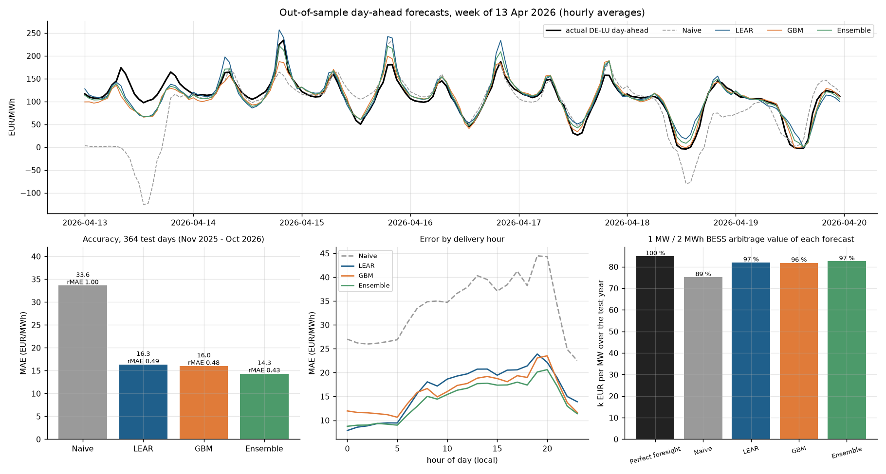
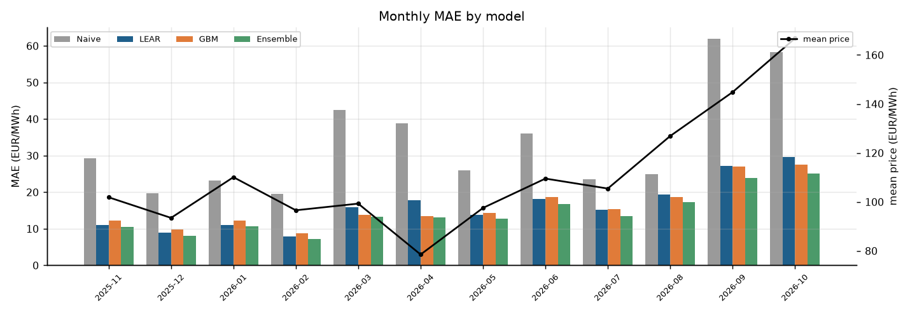
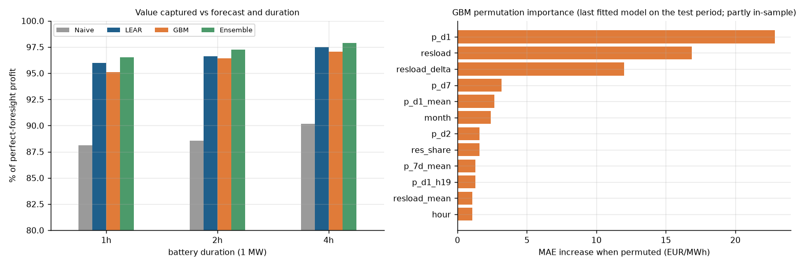
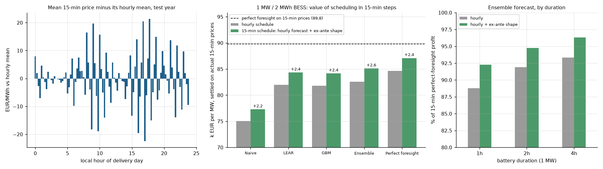
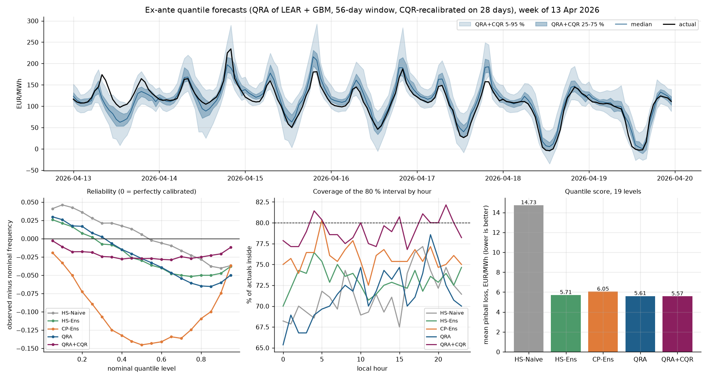

# Germany (DE-LU) day-ahead power price forecasting with LEAR and gradient boosting, and what the accuracy is worth to a battery

Out-of-sample, ex-ante forecasts of the German-Luxembourg day-ahead auction price for **364 delivery days (1 Nov 2025 to 30 Oct 2026)**, built on **real public data** (Energy-Charts / Bundesnetzagentur SMARD prices and TSO day-ahead load, solar and wind forecasts). A naive benchmark, a LEAR-style Lasso model and a gradient-boosting model are compared with standard EPF metrics and Diebold-Mariano tests. Each forecast then drives a **battery arbitrage LP** whose day-ahead schedule is settled on actual prices, which turns forecast accuracy into EUR per MW.

## Headline results (computed by this repo, test year Nov 2025 to Oct 2026)

| Model | MAE (EUR/MWh) | RMSE | sMAPE | rMAE vs naive | 1 MW / 2 MWh BESS profit, k EUR/MW/yr (% of perfect foresight) |
|---|---|---|---|---|---|
| Perfect foresight (upper bound) | 0 | 0 | 0 | - | **84.9** (100 %) |
| Naive (D-1, or D-7 on Mon/Sat/Sun) | 33.6 | 52.6 | 46.3 % | 1.00 | 75.2 (88.6 %) |
| LEAR (24 hourly Lasso, asinh, daily refit) | 16.3 | 26.9 | 27.1 % | 0.49 | 82.0 (96.6 %) |
| GBM (HistGradientBoosting, weekly refit) | 16.0 | 27.8 | 27.6 % | 0.48 | 81.8 (96.4 %) |
| **Ensemble (mean of LEAR and GBM)** | **14.3** | **24.7** | **25.1 %** | **0.43** | **82.5 (97.2 %)** |

Test period: mean price 110.9 EUR/MWh, standard deviation 65.7 EUR/MWh, 452 negative-price hours.

**Key findings**
1. Both ML models halve the naive error (rMAE 0.48 to 0.49). LEAR and GBM are statistically indistinguishable (multivariate DM test p = 0.24), but their **average is significantly better than either** (p = 2e-14 vs LEAR, 1e-11 vs GBM): the two model types make different errors.
2. **Accuracy and battery value are not the same thing.** Halving the MAE only lifts the 2-hour battery's captured value from 88.6 % to 97.2 % of perfect foresight (+7.4 k EUR/MW/yr). Arbitrage depends on the *shape* and *ranking* of hours within a day, and even a naive profile gets the daily solar trough and evening peak roughly right. The gap is larger in volatile weeks: the naive forecast loses money on 12 days, the ensemble on 1.
3. The value gap grows with duration in absolute terms (1 h: +3.8 k, 2 h: +7.4 k, 4 h: +11.3 k EUR/MW/yr for ensemble vs naive), while the % captured is similar (96.5 % to 97.9 %).
4. Errors peak in the evening ramp (hours 18 to 20 local) and in September to October 2026; the most important GBM inputs are yesterday's price at the same hour, the forecast residual load and its day-on-day change.







## Extension: quarter-hour prices (15-min MTU) and what an hourly model leaves on the table

Since delivery day 1 Oct 2025 the day-ahead auction clears **96 quarter-hour prices per day**, so the whole test year is 15-minute. The models above forecast hourly averages. `scripts/run_quarterhour.py` downloads the native 15-min DE-LU prices and asks two questions: how much more can a battery earn by scheduling in 15-minute steps, and how much of that is reachable from the *hourly* forecasts plus an **ex-ante intra-hour shape** (the median deviation of each quarter from its hourly mean over the previous 28 delivery days, all published before D's gate closure, re-centred to sum to zero within each hour). Every schedule is optimised on D-1 information and settled on the actual 15-min prices; same battery assumptions as above, LP in 0.25 h steps.

| 1 MW battery, k EUR/MW over the test year (% of 15-min perfect foresight) | 1 h | 2 h | 4 h |
|---|---|---|---|
| Perfect foresight, 15-min schedule (upper bound) | 48.4 (100 %) | **89.8** (100 %) | 153.2 (100 %) |
| Perfect foresight, hourly schedule | 44.6 (92.1 %) | 84.7 (94.3 %) | 146.0 (95.3 %) |
| Ensemble, hourly schedule (main backtest) | 43.0 (88.8 %) | 82.5 (91.9 %) | 143.0 (93.3 %) |
| **Ensemble + ex-ante shape, 15-min schedule** | **44.7 (92.3 %)** | **85.1 (94.8 %)** | **147.6 (96.3 %)** |
| Naive rule applied directly to 15-min prices | 41.1 (84.8 %) | 78.4 (87.3 %) | 136.6 (89.2 %) |

**Findings**
1. **Hourly scheduling forgoes 4.7-7.9 % of the value even with perfect foresight**: +3.8, +5.1 and +7.2 k EUR/MW/yr for the 1 h, 2 h and 4 h battery. Within-hour deviations are large and systematic (mean absolute 7.8 EUR/MWh): prices fall across the four quarters of the late-morning hours (08-11 local, solar ramping up) and rise across those of the afternoon hours (14-19, solar ramping down); in the 17:00 hour the last quarter averages 44 EUR/MWh above the first (left panel below).
2. **A 28-day median shape, with no new model, recovers 44 % (1 h), 50 % (2 h) and 64 % (4 h) of that uplift** for the ensemble (+1.7, +2.6, +4.6 k EUR/MW/yr). The shaped 2 h ensemble schedule earns more (85.1 k) than an hourly schedule with *perfect* hourly prices (84.7 k).
3. The shape explains **48 % of the intra-hour price variance** out of sample and cuts the ensemble's 15-min MAE from 16.9 to 15.5 EUR/MWh. Window length matters little (7 to 56 days: 84.8 to 85.3 k EUR/MW for the 2 h battery, `results/qh_shape_window_sensitivity.csv`).
4. The remaining gap to the 15-min bound (4.7 k for the 2 h battery) is the part of the intra-hour pattern that changes day to day; a native 15-min model would be needed for it.

The hourly-schedule rows here are settled on the actual 15-min prices; they match the main backtest to within 0.5 % (the difference comes from the interpolated hour of the spring DST day and the hourly averaging in the extract).



## Extension: probabilistic forecasts (QRA and conformal calibration)

The models above are **point** forecasts. `scripts/run_probabilistic.py` turns them into ex-ante predictive distributions for the same DE-LU day-ahead price, scored on **280 days (24 Jan 2026 to 30 Oct 2026)** after a 56-day warm-up (and a further 28 days of residuals before CQR starts adjusting). Nineteen quantile levels (5 % to 95 %) are produced from information available at D-1 gate closure only.

Methods (all causal):
- **HS-Naive / HS-Ens** — historical simulation: residuals of the naive or ensemble point forecast over a rolling 56-day window, added to today's point forecast.
- **CP-Ens** — symmetric split conformal intervals around the ensemble point forecast (Romano, Patterson and Candès 2019 style).
- **QRA** — quantile regression averaging of LEAR and GBM (Nowotarski and Weron 2015): a rolling 56-day quantile regression of the realised price on the two point forecasts, one model per hour and quantile.
- **QRA+CQR** — the QRA fan, then conformalized quantile regression (Romano et al. 2019) on a 28-day residual window, which widens or tightens each interval so that past days are covered at the nominal rate. The median is left unchanged.

| Method (56-day window) | Mean pinball | Median MAE | 50 % cov. | 80 % cov. | 90 % cov. | 90 % width | 90 % Winkler | Brier skill (P(price<0) vs climatology) |
|---|---:|---:|---:|---:|---:|---:|---:|---:|
| HS-Naive | 14.73 | 36.44 | 44.9 % | 71.4 % | 82.2 % | 144.4 | 273.8 | 0.045 |
| HS-Ens | 5.71 | 14.66 | 44.6 % | 73.2 % | 83.6 % | 52.8 | 103.6 | 0.534 |
| CP-Ens | 6.05 | 15.67 | 46.5 % | 75.9 % | 88.2 % | 62.5 | 104.8 | **0.572** |
| QRA | 5.61 | 14.32 | 43.1 % | 71.4 % | 82.0 % | 55.9 | 99.2 | 0.562 |
| **QRA+CQR** | **5.57** | **14.32** | **49.2 %** | **79.0 %** | **89.1 %** | 65.8 | **95.3** | 0.566 |

Pinball and Winkler are in EUR/MWh (lower is better). Nominal coverage is 50 / 80 / 90 %. Width is the mean 5–95 % interval in EUR/MWh. Brier skill is for the implied probability of a negative price, against a rolling climatology; 450 negative hours fall in the scored window.

**Findings**
1. **QRA+CQR is the best-calibrated and best-scored fan.** 80 % coverage rises from 71.4 % (raw QRA) to **79.0 %** (nominal 80 %); 50 % coverage from 43.1 % to **49.2 %**. Mean pinball falls from 5.61 to 5.57 (Diebold-Mariano p ≈ 0.0015 vs QRA, 0.009 vs HS-Ens). CQR does this by *widening* the 90 % interval (55.9 → 65.8 EUR/MWh); the 90 % Winkler score still improves (99.2 → 95.3) because misses are penalised less often.
2. **Historical simulation on the ensemble already beats the naive residual fan by a wide margin** (pinball 5.71 vs 14.73; Brier skill 0.53 vs 0.04). Combining the two point models in QRA is a further, smaller gain.
3. **A better distribution does not raise battery profit here.** On the same 280 days, a 1 MW / 2 h battery scheduled on the QRA or QRA+CQR *median* earns 74.3 k EUR/MW (97.2 % of perfect foresight 76.4 k), slightly *below* the existing ensemble point forecast at 75.1 k (98.2 %). CQR does not change the median, so it cannot improve this LP. Calibration quality ≠ trading value for a median-driven day-ahead schedule (the same pattern as in the quarter-hour and main backtests: shape and ranking matter more than a well-calibrated fan once the point forecast is already good).
4. A shorter 28-day residual window over-covers after conformalization (CP-Ens 80 % coverage 80.3 %, 90 % coverage 91.5 %) but has a slightly worse pinball. The 56-day window is the headline setting.




## Problem
A battery or a trader bidding into the day-ahead auction (gate closure 12:00 CET on D-1) needs a 24-hour price forecast for day D. How good can a transparent, open-data model get, and how much of the perfect-foresight arbitrage value does a battery keep when it commits to a schedule based on that forecast?

## Method
**Data panel.** Hourly UTC data (prices averaged from 15-minute to hourly where the auction was already quarter-hourly) are converted to a local-time day by hour panel. On the 25-hour October day the two 02:00 hours are averaged; on the 23-hour March day the missing hour is interpolated.

**Ex-ante information set for day D.** Prices up to and including D-1 (published on D-2 after the auction), and TSO day-ahead forecasts of load, solar, onshore and offshore wind for day D (published before gate closure). Tests check that no feature for day D contains a day-D price.

**Models.**
- *Naive*: Lago et al. (2021) benchmark, the same hour of D-7 on Mondays, Saturdays and Sundays, D-1 otherwise.
- *LEAR*: 24 separate Lasso regressions (LARS path, penalty chosen by AIC) on median/MAD-normalised, asinh-transformed inputs and target, following the LEAR idea of Lago, Marcjasz, De Schutter & Weron (2021) in simplified form. 248 candidate inputs: 24-hour price profiles of D-1, D-2, D-3, D-7; load, solar and wind forecasts for D and D-1; weekday dummies; a national-holiday flag. It is refit **every day** on a rolling 728-day window. On average 68 of the 248 inputs are selected per hour.
- *GBM*: `HistGradientBoostingRegressor` with absolute-error loss on 25 engineered features (hour, weekday, month, holiday; forecast load, solar, wind and residual load with daily mean, min and max and day-on-day change; renewable share; price lags D-1, D-2 and D-7 at the same hour; D-1 mean, min, max and the 12:00 and 19:00 prices; 7-day mean). It uses an expanding window and is refit **every 7 days**.
- *Ensemble*: simple mean of LEAR and GBM, with no weights fitted on the test data.

**Evaluation.** MAE, RMSE, sMAPE, rMAE against naive, MAE by hour and by month, and the one-sided multivariate Diebold-Mariano test on daily L1 loss differentials (`results/dm_pvalues.csv`: row a, column b gives the p-value of "b is more accurate than a").

**Battery value.** For each delivery day an LP (HiGHS via SciPy) maximises forecast-price profit for a 1 MW battery (1, 2 or 4 MWh). Assumptions: 88 % AC round-trip efficiency, at most 1 equivalent full cycle per day, 5 EUR/MWh wear-cost proxy, starts empty. The schedule is fixed and settled on the **actual** prices. Perfect foresight runs the same LP on actual prices.

## How to run
```bash
python -m venv .venv && source .venv/bin/activate
pip install -r requirements.txt
bash scripts/run_all.sh             # backtest, 15-min extension, probabilistic extension, figures, tests
bash scripts/run_all.sh --download  # refresh the data extract from the Energy-Charts API first
python -m pytest -q                 # 30 tests
```
Outputs go to `results/` (forecasts per model, metrics, DM p-values, BESS value, error by hour and month, permutation importance, `summary.json`; `qh_*.csv` and `qh_summary.json` for the 15-min extension; `prob_*.csv` / `prob_summary.json` for the probabilistic extension) and `figures/`. A CI workflow example is in `docs/ci_example.yml`.

```
src/dapf/      data.py (API download + cache), features.py (DST-safe panel, holidays, ex-ante designs),
               models.py (naive, LEAR, GBM), evaluate.py (metrics, DM test), bess.py (LP in any time step + backtest),
               quarterhour.py (15-min DST-safe panel, ex-ante intra-hour shape),
               probabilistic.py (historical simulation, QRA, split conformal, CQR, pinball, Winkler, Brier)
scripts/       fetch_data.py, run_backtest.py, run_quarterhour.py, run_probabilistic.py, make_figures.py, run_all.sh
tests/         30 pytest tests: DST handling, ex-ante features and shape, holidays, metrics, DM test, LEAR sparsity,
               LP physics, 15-min LP = hourly LP on flat prices, 15-min extract consistent with the hourly one
```

## Data and licence
- **Day-ahead prices, DE-LU bidding zone**, from the [Energy-Charts API](https://api.energy-charts.info) (Fraunhofer ISE). The API states the licence as *CC BY 4.0, from Bundesnetzagentur | SMARD.de*.
- **TSO day-ahead forecasts** (load, solar, wind onshore, wind offshore), Germany, from the Energy-Charts API `public_power_forecast` endpoint. Energy-Charts data are CC BY 4.0 unless stated otherwise, with attribution to Energy-Charts.info.
- **15-minute day-ahead prices, DE-LU**, 1 Oct 2025 to 30 Oct 2026 (`data/de_lu_qh_price.csv.gz`, 37,924 values, no gaps, about 0.2 MB), same Energy-Charts `price` endpoint and licence, not resampled.
- The repo ships a small hourly extract (`data/de_lu_hourly.csv.gz`, 1 Jan 2023 to 30 Oct 2026, about 0.7 MB) under the same CC BY 4.0 terms. Source: Energy-Charts.info / Bundesnetzagentur | SMARD.de; values were averaged to hourly. `scripts/fetch_data.py` rebuilds it.
- Data gap: the solar and onshore-wind day-ahead forecasts for 24 Oct 2026 are empty in the source. They are filled with the previous day's forecast, which is information that was available ex ante.

Code: MIT licence (see `LICENSE`). Data keep their own CC BY 4.0 terms.

## Limitations
- **One bidding zone and one test year.** There are still no fuel or CO2 price inputs (no free, licence-clear daily TTF/EUA series), so level shifts are learned only from lagged prices. Probabilistic fans are now included (QRA + CQR), but they are built on top of the hourly point models, not a native 15-min distributional model.
- **Hourly forecasting models.** The auction has been quarter-hourly since 1 Oct 2025; the models forecast hourly averages. The 15-min extension adds only a historical intra-hour shape on top, not a native 15-min model, and there are only 13 months of 15-min history so far.
- The LEAR here is a simplified variant: one calibration window, a fixed lag set and AIC penalty selection rather than the multi-window ensemble in the original paper.
- The importance ranking comes from the last fitted GBM, which saw most of the test period, so it is descriptive rather than strictly out-of-sample.
- The battery model is a stylised day-ahead-only position: no intraday re-optimisation, balancing or ancillary revenue, grid fees, imbalance cost or degradation feedback, and each day starts empty. The EUR figures are a **backtest on historical prices, not trading performance or a revenue forecast**.
- Published forecasts and prices can be revised by the source; re-downloading may change results slightly.

## References
- Lago, J., Marcjasz, G., De Schutter, B., Weron, R. (2021). *Forecasting day-ahead electricity prices: A review of state-of-the-art algorithms, best practices and an open-access benchmark.* Applied Energy 293, 116983.
- Ziel, F., Weron, R. (2018). *Day-ahead electricity price forecasting with high-dimensional structures: Univariate vs. multivariate modeling frameworks.* Energy Economics 70, 396-420.
- Diebold, F. X., Mariano, R. S. (1995). *Comparing predictive accuracy.* Journal of Business & Economic Statistics 13, 253-263.
- Nowotarski, J., Weron, R. (2015). *Computing electricity spot price prediction intervals using quantile regression and forecast averaging.* Computational Statistics 30, 791-803. doi:10.1007/s00180-014-0523-0
- Romano, Y., Patterson, E., Candès, E. J. (2019). *Conformalized quantile regression.* Advances in Neural Information Processing Systems 32.
